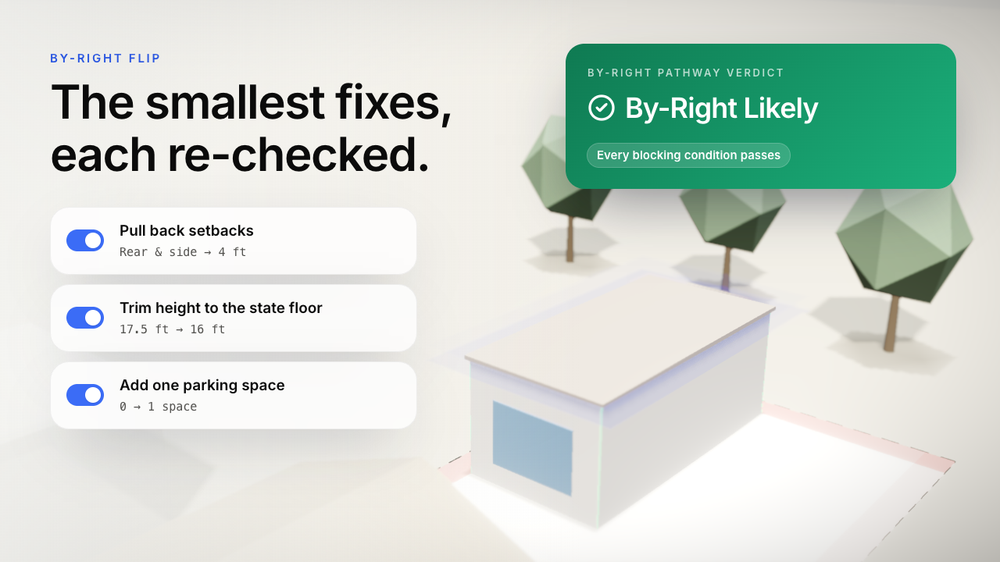

# HouseMax (Permit Fastrak)

> For a homeowner, small builder or permit tech in Orange County: tells you whether an ADU can likely be approved
> **by-right** (no hearing), proves it with the statute text, and shows exactly what is still unknown.

**Team:** HouseMax
**Members:** Winston Ta (backend), Rishabh Vira (frontend), Alina Zheng (frontend-Anthropic presentation), Chandu Siram (ideation, APIs, legal auditing) 
**Lane:** 2 Clear it
**Built at:** Claude Impact Lab: UCI × SoCal Affordable Housing, November 7, 2026
**Live demo:** [house-max-sepia.vercel.app](https://house-max-sepia.vercel.app/)

> **Prototype only. Not legal advice.** Verdicts are "likely" outcomes based on the written rules encoded here.
> Final determination rests with city staff. Nothing in this tool files an application or contacts a city.

## The real user

A first-time homeowner adding a detached ADU (lane scenario C01) or a city permit tech who wants to give the right
answer the first time (C03). State law says an ADU permit is ministerial, with no hearing (Gov. Code § 66317(a)(1)),
but city checklists still cite renumbered law and local forms can add discretionary steps.

**Before:** read the city checklist, the 2024 renumbering of ADU law and HCD guidance by hand, and guess whether a
hearing is coming.
**After:** enter the project, answer the one or two questions the tool ranks first, and get a verdict that cites the
exact statute subsections it relied on, each with the date we read it on leginfo.

## What we built

A Next.js 16 app (`frontend/`) with a backend in the same app (`frontend/app/api`, `frontend/lib/backend`).

| Feature | What it does |
|---|---|
| By-Right Verdict | Three states: By-Right Likely / Discretionary Likely / Can't Tell Yet. **By-Right only when every blocking condition passes on a rule a person verified against the statute text.** Unknown inputs never count as "no". |
| Follow-up questions | Ranks the missing facts that block a verdict. |
| By-Right Flip | Smallest design change that resolves a failing or unknown condition, each re-checked by running the engine again. |
| Conflict Radar | Finds renumbered statute citations (e.g. Gov. Code § 65852.2 → §§ 66310–66342) in any checklist text, and flags discretionary-review language (HOA sign-off, subjective design review, hearings). Paste any city checklist to scan it. |
| Two-Clock Ledger | ADU statutory clocks (15 business days to completeness, 60 days to decide, § 66317(a)(2)–(3)) next to real permit-to-occupancy medians from HCD APR data. |
| Draft packet PDF | 4-page draft rendered on the server (`@react-pdf/renderer`): cover, spec matrix, applicant's statement citing only the rules relied on, pre-flight checklist. Watermarked DRAFT on every page. |

## Demo

**Try it live:** [house-max-sepia.vercel.app](https://house-max-sepia.vercel.app/)

**Promo video (60 s):** click the poster to watch.

[](byright-promo.mp4)


**Walkthrough video:** [byright-demo.mp4](byright-demo.mp4)

### Demo walkthrough

1. **Intake:** the demo ADU starts at **Can't Tell Yet**: 17.5 ft is only guaranteed near transit. Answer "Yes, within ½ mile" and it becomes **By-Right Likely**; the banner shows "Computed by backend · 0 of 2 cited statutes not yet verified".
2. **Flip:** answer "No" instead: the height is above the 16 ft every city must allow, so the verdict is Can't Tell, and the flip "trim to 16 ft" resolves it.
3. **Conflict Radar:** each clause shows the backend's automatic scan; paste a real checklist into "Audit any checklist".
4. **Clocks:** statutory deadlines plus Santa Ana's real APR median (287 days from permit to occupancy, 682 projects).
5. **Package:** "Generate draft packet", then "Open server-rendered PDF".

## How Claude is used

- **Building it:** Claude Code wrote the backend, verified statute text on leginfo, pulled and summarized APR data,
  and wrote the tests, working from a plan the team approved (`docs/backend-plan.md`).
- **Inside the tool:** no Claude calls at runtime yet. The planned next feature turns a pasted city checklist into
  structured items with suggested citations, marked `AI_SUGGESTED` until a person confirms them.

## Try it

```bash
cd frontend
npm install
npm run dev        # http://localhost:3000
npm test           # 71 tests: engine safety, API routes, data honesty, PDF render
```

Needs Node 20+ (built on Node 24). No environment variables are needed. `ANTHROPIC_API_KEY` is only for the planned
Claude feature; put it in `frontend/.env` (gitignored). Refresh the APR data with `node frontend/scripts/fetch-apr.mjs`
(23 requests to data.ca.gov).

Backend API reference: [`docs/BACKEND.md`](docs/BACKEND.md).

## Sources and assumptions

### Statutes (read on leginfo.legislature.ca.gov on 2026-11-07)

| Rule | Citation | Used for |
|---|---|---|
| ADU permits are ministerial, no hearing; 15 business days to completeness; 60 days to decide, else deemed approved | Gov. Code § 66317(a)(1)–(3) | Verdict basis, clocks, applicant's statement |
| Lot must be residentially zoned with a proposed or existing dwelling | Gov. Code § 66314(d)(2) | Primary-dwelling check |
| Detached ADU floor area ≤ 1,200 sq ft; side/rear setback no more than 4 ft; parking ≤ 1 per unit or bedroom | Gov. Code § 66314(d)(5), (d)(7), (d)(10) | Size, setback, parking checks |
| Objective standards, including architectural review | Gov. Code § 66314(b)(1) | Discretion Detector basis |
| City must allow at least 16 ft; at least 18 ft within ½ mile walking distance of a major transit stop | Gov. Code § 66321(b)(4)(A)–(B) | Height check (these are floors, not caps) |
| No ADU parking standards within ½ mile walking distance of public transit | Gov. Code § 66322(a)(1) | Parking check |
| One ADU + one JADU, plus one detached new ADU, on a single-family lot | Gov. Code § 66323(a)(1)–(2) | Unit-count check |
| Coastal ADU: coastal permit still required, decided in 60 days, no hearing required | Gov. Code § 66329(a); Pub. Res. Code § 30600(a) | Coastal check (advisory) |
| No minimum parking within ½ mile of a major transit stop | Gov. Code § 65863.2 (AB 2097) | Multifamily parking |
| 30-day completeness determination | Gov. Code § 65943(a) | Non-ADU clock |
| ADU law renumbered from § 65852.2 to §§ 66310–66342 (SB 477, Stats. 2024 Ch. 7) | leginfo chapter history | Stale-citation detection |

Each rule's URL, check date and who checked it are in `frontend/data/regulations.json` and on the Registry screen.

### Data

| Item | Source | Date |
|---|---|---|
| Permit → certificate-of-occupancy medians by city | HCD Housing Element APR, Table A2, data.ca.gov (resource `fe505d9b-…`) | Pulled 2026-11-07 |
| City ADU page links (Santa Ana, Anaheim, Irvine) | Lane 2 `DATA-SOURCES.md` (VERIFIED there) | 2026-11-06 |

### Not verified (labeled in the tool)

| Item | Status |
|---|---|
| SB 684 (Gov. Code §§ 65852.28, 66499.41) | UNVERIFIED: leginfo shows four versions of each (Stats. 2026, Ch. 1006); the operative one was not determined. Missing-middle projects therefore stay at Can't Tell Yet. |
| SB 35 / SB 423 (Gov. Code § 65913.4) | UNVERIFIED: not read in full. The 10% affordability threshold is from the spec. |
| JADU § 65852.22 → § 66333; 2025 renumberings (66324 → 66311.5, 66327 → 66313.5, 66332 → 66311.7) | UNVERIFIED: from the lane source list citing the HCD ADU Handbook; the Handbook was not opened. |
| Delay figures: Planning Commission +193 days, Site Plan Review +106, EIR +504; ministerial 434–492 vs 731 days; RAND stage delays | UNVERIFIED: from the spec; the sources were not opened. Shown with that label. |
| Carrying-cost defaults ($350k / $4.8M capital, 0.75%/month) | ASSUMPTION |
| "Who owns the delay" split (6 external / 9 applicant days) | ASSUMPTION |
| Multifamily 90-day decision window | ASSUMPTION |
| Every city checklist in `cities.json` | ILLUSTRATIVE: written for the demo, not taken from any city's actual checklist |
| Pre-approved plan dimensions in `plans.json` | ILLUSTRATIVE |
| Demo projects, parcels and applicants | Made up. No real person, address or APN. |

## What is real and what is mocked

| Part | Status |
|---|---|
| Verdict engine, follow-ups, flips (ADU) | Working, on verified statutes |
| Verdict engine (missing-middle) | Working, but always Can't Tell Yet until SB 684 / SB 35 are verified |
| Stale-citation detection and Discretion Detector | Working on any text |
| City checklists | Mocked (illustrative) |
| APR timing medians | Working, real data |
| Statutory clocks and shot-clock draft letter | Working (ADU); multifamily decision window is an assumption |
| Draft PDF packet | Working |
| Parcel lookup (address → transit, coastal, fire zone) | Not built: the user answers these |
| Claude checklist extraction | Not built yet |

## Where it gets things wrong

- **Local limits are not on file.** An ADU above 16 ft (or 18 ft near transit) gets "Can't Tell", because whether the city allows more depends on a local ordinance we haven't loaded.
- **Inputs aren't checked against records.** Transit, coastal and fire-zone answers are self-reported, so confidence stays LOW.
- **Only ADUs are fully encoded.** SB 9, SB 684, SB 35 and JADU-specific rules are not. Multifamily ADU allowances (§ 66323(a)(3)–(4)) are not modeled.
- **Business days skip weekends only.** Holidays are not modeled.
- **The APR data can't show approval speed.** It has no application dates. Permit-to-occupancy includes construction time.
- **The stale-citation check finds numbers, not meaning.** It does not decide whether a local rule is substantively preempted; that stays with a person.

## Next steps

1. Transcribe one real city checklist (Anaheim's November 2025 ADU checklist still cites § 65852.2) as the first VERIFIED checklist. A permit tech signs off in the Registry.
2. Verify the operative SB 684 text and encode it, so a 4–12 unit project can get a real verdict.
3. Parcel lookup from County of Orange GIS for transit, coastal and fire-zone facts, which raises confidence.
4. Claude-assisted checklist extraction, so the next 30 Orange County cities can be loaded in hours, each item marked AI_SUGGESTED until reviewed.

## Data and privacy

This project uses only public or provided data. It contains no personal information about real tenants, buyers or
residents. APR data is reduced to aggregate medians; no addresses or APNs are stored. It does not file applications
or contact any city or person.

## License

MIT, see [LICENSE](LICENSE).
